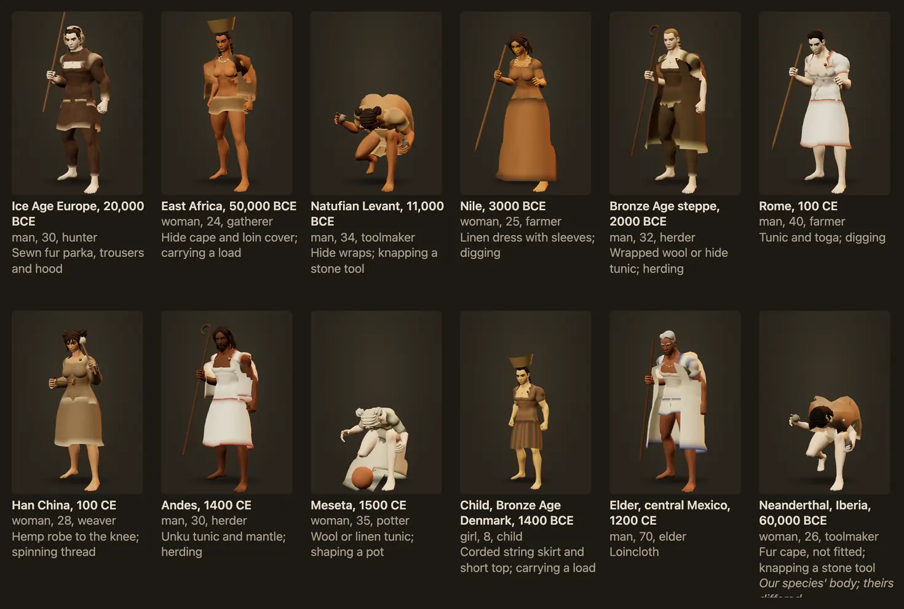

# The 3D person in the card (`?avatar=3d`)

Off by default until Will has reviewed it on prod. With `?avatar=3d`, clicking a person at street zoom shows a small
three.js figure in the card (`GroundingPanel`) instead of the SVG drawing (`overlays/Portrait.tsx`): a rigged human that
idles, now and then glances aside, and turns when dragged. Without the flag nothing changes: no pixel (`pnpm visual`)
and no byte of the first load (`node scripts/first-load.mjs --flags`).

It is an **imagined illustration of the kind of person, never a likeness**, and the caption says so. Part 1 (task 0018)
is the figure and the viewer; part 2 (task 0019) dresses it by era, region, climate and way of life from a cited table,
gives it hair, ornaments and a tool for its role, and a work loop that alternates with the idle.



*Contact sheet (`node footstep-generator/avatar/sheet.mjs`, 2026-11-24): still frames, work at full strength, atlas records
from prod. Caption lines are the card's.*

## Assets and licence

| Pack | Source | Licence | sha256 of the zip |
|---|---|---|---|
| Universal Base Characters [Standard] (free) | [quaternius.com](https://quaternius.com/packs/universalbasecharacters.html), itch upload 15861669 | CC0 1.0 | `fdbf1804…5f40` |
| Universal Animation Library [Standard] (free) | [quaternius.com](https://quaternius.com/packs/universalanimationlibrary.html), itch upload 17958403 | CC0 1.0 | `cc73fc4e…7724` |

Both pages show "License: CC0" and both zips carry `License.txt` ("CC0 1.0 Universal ... Public Domain Dedication"),
checked 2026-11-24. Full URLs, versions and hashes: `footstep-generator/avatar/sources.json`; the built files and their
hashes: `footsteps-web/public/avatar/manifest.json`. No paid or non-commercial asset is used.

The packs share one 65-joint UE-style skeleton (`root`, `pelvis`, `spine_01-03`, `neck_01`, `Head`, arms, fingers, legs).
The free bodies are an adult man and woman ("Superhero" meshes, ~7,300 vertices each); the kit has no child.

## Build

```bash
pnpm --dir footstep-generator/avatar install
node footstep-generator/avatar/build.mjs            # downloads into data/raw/avatar/ (not in git), checks sha256, writes public/avatar/
node footstep-generator/avatar/build.mjs --zips DIR # zips you already have
```

The download uses itch.io's free-download flow (no account). A changed upload fails the sha256 check: check the
licence again before updating `sources.json`.

What it writes (meshopt, no textures):

| File | What | KiB |
|---|---|---|
| `body_male.glb`, `body_female.glb` | body, eyes, eyebrows, and a tunic shell, skinned | ~190, ~198 |
| `piece_<name>_{male,female}.glb` | one garment piece each (13 × 2): `vest`, `shortsleeve`, `longsleeve`, `trousers`, `hood`, `drape`, `loin`, `skirt_short`, `skirt_knee`, `skirt_long`, `strings`, `cape`, `cloak` | 22-54 |
| `hair_{long,buns,parted,buzzed,buzzed_female,beard}.glb` | one skinned hair mesh each | 25-63 |
| `anims.glb` | skeleton + 9 clips: `idle`, `talk`, `walk`, `sit`, `crouch`, `work` (`Fixing_Kneeling`), `hold` (`Idle_Torch_Loop`), `dance`, `push` | ~314 |
| total | | ~1,677 KiB (all 35 files) |

One person loads a body, one hair file, maybe the beard, 1-4 garment pieces and `anims.glb`: about 0.6-0.75 MB, once per
visit (files are cached for the visit, so a second person mostly reuses them). Tools, ornaments, caps, braids and
topknots are three.js primitives built in the viewer: no bytes.

**No textures.** The pack's PNGs are 1-4 MB each and would need a KTX2 toolchain. The build samples them once into vertex
colours instead: `COLOR_0 = (shade / 1.5, garment, trim)`. *Shade* is the base-colour texture's brightness against its
typical skin pixel (muscle and face shading); *garment* is 1 on the pack's painted underwear and on every garment piece;
*trim* marks a piece's hem, cuffs, neck and a hood's ruff. Eyes keep their texture's RGB. The viewer turns these into the
person's colours on the CPU, so the same files serve every person.

**Garment pieces** (`footstep-generator/avatar/pieces.mjs`), made from each body in its bind pose so they fit and bend
with the rig; no CC0 clothing exists for this skeleton:

- *Shells* (tops, trousers, hood, the toga/shawl drape): the body's own triangles inside a region, pushed out 1-3.5 cm
  along their normals. The body file carries `_COVER`, a bit per fitted piece on each vertex well inside its region; the
  viewer drops body triangles a worn piece covers entirely, so skin never pokes through cloth.
- *Lathes* (loincloth, skirts, string skirt, cape, cloak): rings round the body from a top height to a hem, at each height
  just wider than the body (sampled from its vertices), never narrower than the ring above, flaring as they fall; capes and
  cloaks are open at the front and come in to the neck. Each vertex copies the nearest body vertex's weights (calves and
  feet count as the thigh), blended 55% with the pelvis below the hips so a skirt does not split between the legs. A
  string skirt's strands are trim and shadow stripes.

Clips keep rotation tracks for every joint and the pelvis translation; scale tracks and other translations are dropped
(they carry nothing visible, and the body's own bone lengths are kept). The build fails if a clip drives a joint the
bodies lack.

## From a person to a figure

`lib/avatar.ts` is shared by the SVG and the 3D figure, so they agree:

- `portraitLooks(person, year, lat, record)`: skin (atlas palette, else a wide light-to-deep range nudged deeper toward the
  equator), hair (atlas palette, else dark with lighter shades above 45°; grey for 55+), clothing colours (era and way of
  life defaults, atlas palette over them) and hair style (atlas phrases, else by sex). Its random draw order is the SVG's,
  unchanged: the SVG still draws exactly what it drew before (checked on 210 people against the old code).
- `avatarSpec(person, looks, { year, rec, state })` (`lib/avatarSpec.ts`, kept apart so it loads only with the viewer): the figure. Body by sex (children use the man's body: before puberty bodies differ little
  by sex, and the woman's mesh is an adult's); height from a growth fit (77 + 6.1 × age cm against 170 cm, close to the
  WHO medians) for under-18s, 0.98 for elders; a bigger head for children (`Head` bone × 1 + 0.6 × (1 − height)); elders
  (55+) stoop (0.2-0.4 rad over spine and neck, the head lifted back to look ahead) and idle at 0.8× speed. Adult men get
  a beard 40% of the time. Beard, idle phase, glances and everything below draw from a second seed, so the SVG is untouched.
- Clothes, hair and ornaments from the wardrobe (below); tool and work loop from the role (below).
- Other kinds of human (`Person.kindOfHuman`) get the same figure and the line "Illustration of our own species' body;
  their build differed." No body-proportion change is applied: none was both cited and cheap enough. They wear a draped
  hide or fur cape, never fitted clothes (Collard et al. 2016), whatever the atlas model says.

## The wardrobe (`lib/wardrobe.ts`)

An outfit is pieces by slot, `top` (none, vest, short or long sleeves), `bottom` (none, loin, short, knee, long, string
skirt, trousers), `over` (cape, cloak, drape), `head` (hood, cap, head cloth), in one material (fur, hide, bark, plant
fibre, linen, wool, cotton, silk, felt), plus a caption. A long-sleeved top over trousers (a coat or parka) also gets
coat tails. The table's 28 rows each name an era band and, where it matters, regions, climate and way of life; the most
specific match wins (other kind of human, then region, climate, way), the narrower era on a tie. Each row lists outfits
(some only for women or men), hair-dos, ornaments, a face-paint chance and sometimes a cloth palette.

- **Region** from rough culture-area boxes (`regionOf`: arctic, nile, near-east, mediterranean, steppe, europe, south-asia,
  east-asia, mesoamerica, andes, americas, africa, oceania), first match wins. **Climate** from latitude as
  `lib/footwear.ts` does, colder in the glacial: cold at |lat| ≥ 50, or ≥ 40 before 10,000 BCE; hot below 23.
- **Sources**: every row cites at least one; each source is `checked` (found on Crossref 2026-11-24, title, year and
  authors as cited, and the title or abstract states the claim) or `unverified` with why. Checked: Toups 2011 (lice,
  clothing ≥ 83 ka), Gilligan 2010 (simple vs fitted clothing), Collard 2016 and Wales 2012 (Neanderthal clothing),
  Henshilwood 2004, Bouzouggar 2007, Hoffmann 2018 (shell beads, pigments), Soffer 2000 (string skirts on figurines),
  Kvavadze 2009 (30 ka flax), the Tarkhan dress (linen, 3482-3102 BC), O'Sullivan 2016 (Ötzi's hide clothing), Frei 2015
  (Egtved girl), Olson 2017 (tunic and toga), Beck 2014 (Turfan trousers), Moulherat 2002 (Mehrgarh cotton), Gong 2016
  (8,500-year-old silk), Splitstoser 2016 (Huaca Prieta indigo cotton), Murra 1962 (Inca cloth). Unverified (found, not
  read for this claim): Bar-Yosef 1998's Natufian shell headgear, Sikora 2017's Sunghir beads, Vogelsang-Eastwood 1993,
  Hallstatt Textiles, Croom 2002, Rudenko 1970, the Han-clothing article, Anawalt 1981, the Inuit skin-clothing book, the
  bark-cloth chapter, and rows on general ethnographic reading (later Europe, Africa and Americas farmers, early steppe).
- **The atlas over the table**: garment phrases map to pieces and materials by pattern (`atlasPieces`); the atlas's
  caption replaces the row's when it applies. A record whose clothing source is real overrides the table; a modelled
  gap-fill (`source: model`) overrides only a row resting on unverified sources, never a checked row or other humans.
  Ornaments and face paint follow the same rule. The atlas palette always colours woven cloth (as the SVG).
- **Colours**: fur, hide, bark and plant fibre take the material's own colours; woven cloth takes the atlas palette, else
  the row's (white linen on the Nile, Han, Andes and steppe dyes), else the era's from `portraitLooks` (undyed before
  2000 BCE, madder, indigo, weld after), so the SVG and the figure agree there. Fur and hide vary vertex to vertex; silk
  has a sheen.
- **Hair**: the atlas's styles where it has them, else the row's hair-dos: loose → long, tied → buns, braids → short
  hair plus two braids, topknot → short hair plus a knot, cropped → parted or buzzed, covered → buns in the cloth colour
  (a head cloth). Under a hood or cap the hair is short.
- **Ornaments** (primitives on bones): shell or stone beads at the neck, a torc, a bronze pin, earrings, a headband; each
  of the row's worn 60% of the time, at most two; metal only after 2500 BCE. Ochre lines on cheeks and brow when painted.
- Small children (under 5) in the warmth wear little: a loin cover.

## Tools and work (`lib/avatarWork.ts`)

`workFor(role, year, region)`: forager and gatherer dig with a digging stick or carry a basket; hunter holds a spear,
fisher a harpoon, fire-keeper a torch; toolmaker knaps (hammerstone and core); herder and shepherd herd with a crook;
milker carries a pot; weaver spins (spindle and distaff); tanner scrapes a hide; potter shapes a pot; farmer reaps with a
sickle, grinds on a quern or digs; builder carries a basket; elder holds a staff or knaps; child carries a small basket or
idles. Era gates: no pot before pottery (16,000 BCE in East Asia, 9500 BCE in Africa, 7000 BCE elsewhere: a basket
instead), no spindle before 7000 BCE.

Each loop is a pack clip plus keyframed bone turns (`workPose`, about figure axes, applied after the clip as the stoop and
glances are): knapping and pot-shaping crouch (`crouch`), grinding and scraping kneel (`work`), spinning, herding (a wave
of the free arm every few seconds), digging and reaping stand (`idle`), holding uses the idle with the forearm forward so a
shaft stands upright. Work and rest alternate (`workWeight`: work 6-12 s, rest 3-6 s, half-second ramps, per person);
the head glances only while resting. Holding and carrying never rest. Loads ride on the head, hands free.

With `?routine=1` (docs/ops/routine.md) the state when the card opens chooses instead: asleep → seated, head bowed;
playing → the dance clip; walking out or back → the walk clip with what they carry; there → the trip's work (gathering
digs, hunting and fishing hold a spear, water and wood carry a pot or basket, fields reap or dig, herding herds, visiting
talks); at the hearth → the role's work. The caption reads "<outfit>; <doing>".
- Deterministic: the seed is the person's spot and id (`personSeed`).

## The viewer

`components/footsteps/overlays/Avatar3D.tsx` (React) and `avatarScene.ts` (three.js), loaded through
`overlays/avatarLazy.ts` (`lib/lazyModule.ts`): never in the first load; with the flag on, the code is prefetched once the
first people are drawn, and the GLBs load when a person is first selected. The SVG shows until the code is in, and again if
WebGL or a file fails.

- 120 × 168 px canvas, up to 2× pixel ratio, ACES tone mapping. Soft studio light: a warm hemisphere, a key from the front
  left, a warm orange rim from behind on the right; a soft round shadow under the feet. Framed for an adult, so a child
  stands smaller.
- The idle clip loops from a per-person phase; every 4-10 s the head glances up to ~30° aside and back (`glanceAt`). The
  pack's rig has no eye bones, so the head turns, not the eyes.
- Drag turns the figure (with a short coast). It never turns by itself.
- `?still=1` or `prefers-reduced-motion: reduce`: one fixed frame (the clip at `STILL_SECONDS`, no glances), redrawn only
  when dragged.
- Draws at most 30 frames a second, only while the canvas is on screen (IntersectionObserver) and the tab is visible; the
  WebGL context is released when the card closes.
- Adjustments after the clip (stoop, glances) are undone before each update: three's mixer only rewrites a bone when its
  animated value changes, so an adjustment left on a bone would pile up.

## Measure

```bash
pnpm --dir footsteps-web build
node footsteps-web/scripts/avatar-shots.mjs <dir>      # three people, card flag off and on, bytes, first frame, fps
```

It finds a forager child at 50,000 BCE (East Africa), a farmer woman at 3000 BCE (Nile) and an elder man in 1500 CE
(Meseta) at street zoom, checks the card names the wanted person, and writes `<scene>-{off,on}.png`,
`avatar-report.{json,md}`.

Measured 2026-11-24 on the local static export (M-series Mac, headless Chromium on Metal, a busy machine: the page ran
at only 11-14 fps with or without the card; what matters is the difference). First frame and bytes come from a fresh
browser context per scene, clicking the person once after the viewer's code had been prefetched:

| Scene | Person | Viewer code (JS the default visit never loads) | GLB files | First frame from click / from mount | Page fps: no card · card open · card offscreen · card closed | Canvas fps · frames drawn offscreen in 3 s |
|---|---|---|---|---|---|---|
| Forager child, 50,000 BCE (East Africa) | girl, 10 | 166 KiB | 490 KiB | 259 / 95 ms | 13.6 · 13.2 · 13.3 · 13.0 | 10.5 · 0 |
| Farmer woman, 3000 BCE (Nile) | woman, 18, farmer | 166 KiB | 497 KiB | 301 / 152 ms | 12.2 · 12.5 · 11.8 · 14.1 | 10.0 · 0 |
| Elder man, 1500 CE (Meseta) | man, 78, elder | 166 KiB | 456 KiB | 198 / 101 ms | 12.2 · 11.9 · 10.8 · 11.1 | 9.5 · 0 |

- No fps drop with the card open (differences are within run-to-run noise); the canvas draws nothing while off screen and
  starts again when back.
- The default first load gains 866 B of raw JS (the flag read and the lazy hook), no avatar or three.js code:
  1,596,694 → 1,597,560 B across the 11 scripts in `index.html` (base 751de0b vs this branch). `first-load.mjs --flags`:
  `?avatar=3d` loads its chunk, the default visit does not.
- `pnpm visual` (flag off): all ten scenes pass; `rome-1000bce-person` (the SVG portrait) differs by 2 px, within the
  usual run-to-run noise.

Part 2, measured 2026-11-24 the same way (same busy machine, `avatar-shots.mjs`): the viewer's code is 178 KiB (was 166);
the files one person loads are 545 KiB (forager girl: body, short hair, clips, loin cover, cape), 607 KiB (Nile farmer
woman: linen dress, long hair) and 637 KiB (Meseta elder: coat, hose and tails, beard). First frame from click 101-204 ms,
page fps unchanged with the card open (11.2-13.2 in all four states), 0 canvas frames while offscreen. All 35 avatar files
total 1,677 KiB. `pnpm visual` (flag off): all ten scenes pass, `rome-1000bce-person` at 0 px.

## Checks

- `lib/avatar.test.ts`: determinism, latitude pull, atlas palettes, elder grey, child build, hair mapping, beards, cloth
  colours equal the SVG's where they should, the 3D draws do not move the SVG's, outfit/tool/loop by era, place and role,
  the routine state.
- `lib/wardrobe.test.ts`: every row sourced; a row for anyone anywhere; regions and climate; the contact-sheet people's
  rows and outfits; small children; determinism; atlas overrides (real source yes, model over a checked row no).
- `lib/avatarWork.test.ts`: tools by role, era gates, routine mapping, keyframes name rig bones and stay in range, loops
  move, work and rest alternate deterministically.
- `node footstep-generator/avatar/sheet.mjs [out] [--only ids] [--at s] [--offline]`: the contact sheet.
- `pnpm visual` (flag off): unchanged. `node scripts/first-load.mjs --flags`: `?avatar=3d` loads its chunk, the default
  visit does not.

## Known limits (part 2 and later)

- The bodies are the pack's athletic "Superhero" meshes; arms and legs read muscular, children included.
- Shell pieces follow the body's triangles, so their edges are stepped at close range (the trim band hides most of it);
  kneeling and crouching push knees through long skirts and capes bunch on the back.
- Keyframed work is coarse: hands near, not on, the work (no IK). The sit clip has no seat.
- Eyes do not move (no eye bones). No footwear on the figure yet (the footprints have it: `lib/footwear.ts`).
