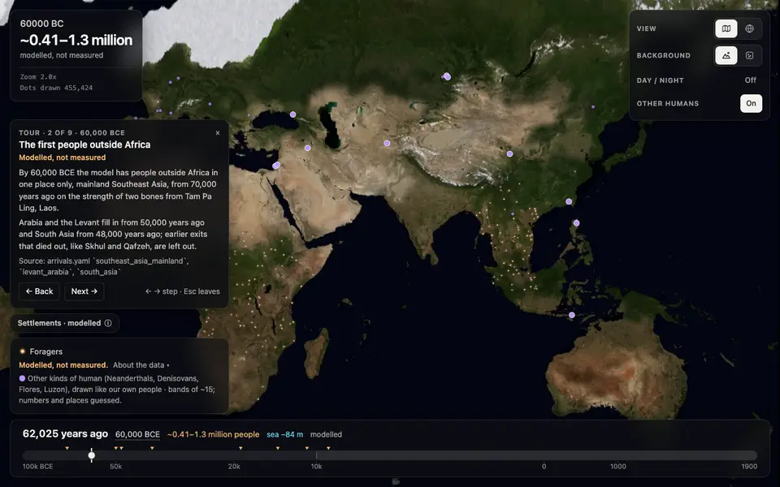
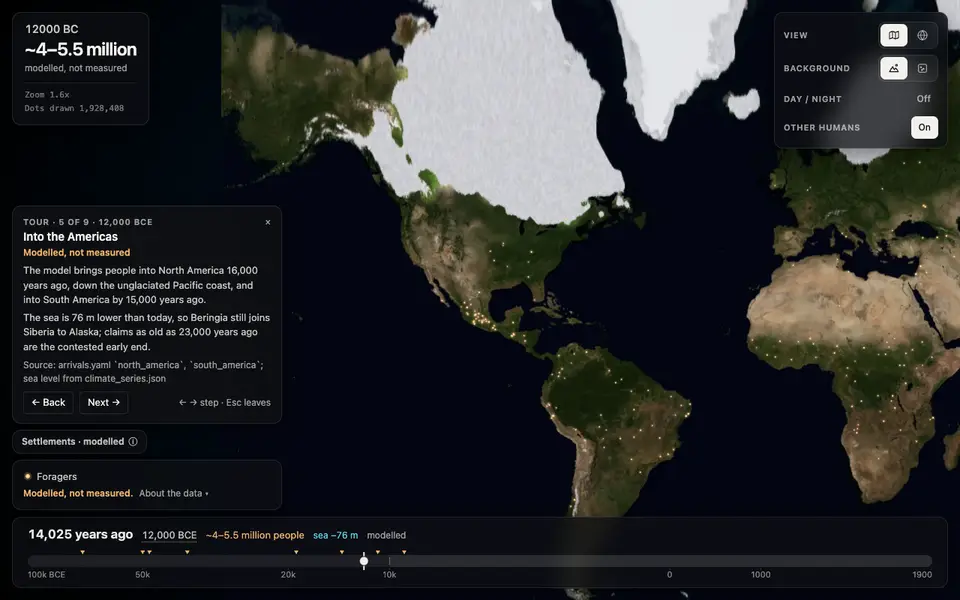
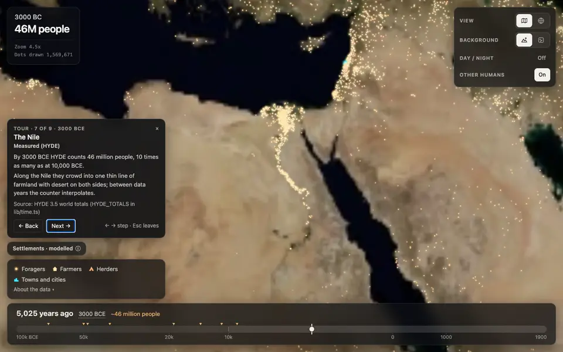

# Guided tour (`?tour=1`)

A first-time visitor does not know where to look. With `?tour=1` the app walks them through nine stops from
100,000 BCE to 1900 CE. Each stop flies the camera to a view, sets the year on the slider and shows a card at the top
of the left column: the stop, its year, whether the people there are **measured** (HYDE) or **modelled** (the pre-HYDE
model), two sentences that say what the screen shows and where the number comes from, and a source line.
`imagined` is allowed too, for a stop about imagined detail; no stop uses it yet. Without the flag nothing changes.

| | |
|---|---|
| Stops and wording | `footsteps-web/lib/tour.ts` (`TOUR_STOPS`) |
| Driving it | `components/footsteps/hooks/useTour.ts` (mounted in `FootstepsViz.tsx`, year through the page's `setTime`) |
| Card | `components/footsteps/overlays/TourPanel.tsx` |
| Tests | `lib/tour.test.ts` |
| Real-app run | `node scripts/tour-shots.mjs <out-dir>` (after `pnpm build`) |

## Controls

- **Next / Back** buttons, or **→ / ←**. Next on the last stop says **Finish** and leaves the tour.
- **Esc** or **×** leaves the tour and removes `tour=1` from the address (`history.replaceState`).
- The arrow keys belong to the time slider while it has focus (and to any text field); the tour leaves those alone.
- A flight takes 2.4 s (`FLY_MS`). A press, wheel or any other key during it (a drag, a zoom, WASD) stops it where it is:
  the tour never fights the user's own camera. The stop and its year stay; Next or Back flies again.

## Where the numbers come from

No number in the wording is typed in. Each is computed when the app is built from the data the counter and map use,
or pinned by a test to its source:

- World totals: `PEOPLE_TOTALS` (`lib/time.ts`): the pre-HYDE model's `prehistory_totals.json` (low / central / high)
  and HYDE's `HYDE_TOTALS`, worded by `populationLabel`, as the time bar words them.
- Arrival dates: `arrivals.yaml` (`footstep-generator/prehistory/`). The web build cannot read YAML, so `ARRIVAL_KA` in
  `lib/tour.ts` copies the ten values the tour quotes and `tour.test.ts` reads each one back from the YAML.
- Last-seen dates of the other humans: `OTHER_HUMANS[].lastKa` (`lib/otherHumans.ts`, itself kept in step with the YAML).
- Sea level: `seaLevelAt` (`climate_series.json`).

`tour.test.ts` extracts every number from each stop's two sentences and requires the set to equal the numbers worked out
straight from those files (plus the stop's own year), so a changed total, date or sea level changes the wording and a
typed-in number fails the test. It also checks 8-10 stops, years ascending, on a people-image year, inside the slider,
and the label against `evidenceAt`.

## Choices against the task's example arc

- **Leaving Africa (60,000 BCE):** in the model the only region outside Africa then is mainland Southeast Asia (70 ka,
  Tam Pa Ling); Arabia and the Levant start at 50 ka. The card says so rather than show an exit the model does not have.
- **Americas:** the model's arrival is 16 ka BP (14,050 BCE) with a 3 ka ramp, so 14,000 BCE showed no one. The stop is at
  12,000 BCE, where the fires are visible.
- **Rome:** year 0, HYDE's "0 AD" data year (the stats panel calls it 1 CE).
- **Sahul:** the era image keeps today's Torres Strait, so the card gives the sea level, not "the shelf is dry".

## First-draft wording (for Will to edit)

Edit the strings in `TOUR_STOPS`; keep the `${...}` numbers, and if a new number is added, add its source to
`expected` in `tour.test.ts`.

### 1. Everyone is in Africa — 100,000 BCE · Modelled, not measured

Camera: 2, 20, zoom 2.2, pitch 0. Source: prehistory_totals.json (prehistory_population.py); arrivals.yaml `africa`.

> In 100,000 BCE all of our own kind live in Africa (the lavender fires elsewhere are other kinds of human): the model puts us at about 200 thousand people, somewhere between 100 thousand and 400 thousand.
> Africa counts as lived in from 300,000 years ago (Jebel Irhoud), and the fires are a published population curve spread by climate, not head counts.

### 2. The first people outside Africa — 60,000 BCE · Modelled, not measured

Camera: 12, 68, zoom 2, pitch 0. Source: arrivals.yaml `southeast_asia_mainland`, `levant_arabia`, `south_asia`.

> By 60,000 BCE the model has people outside Africa in one place only, mainland Southeast Asia, from 70,000 years ago on the strength of two bones from Tam Pa Ling, Laos.
> Arabia and the Levant fill in from 50,000 years ago and South Asia from 48,000 years ago; earlier exits that died out, like Skhul and Qafzeh, are left out.

### 3. Across the sea to Sahul — 46,000 BCE · Modelled, not measured

Camera: -14, 135, zoom 2.6, pitch 0. Source: arrivals.yaml `sahul`; sea level from climate_series.json.

> People reach Sahul, the one landmass of Australia, New Guinea and Tasmania, in the model 50,000 years ago, when the sea stood 77 m lower than today.
> That is the consensus date: an older date of 65,000 years ago at Madjedbebe is disputed, so the model does not use it.

### 4. The other kinds of human fade — 38,000 BCE · Modelled, not measured

Camera: 46, 15, zoom 3.2, pitch 0. Source: otherHumans.ts (Higham et al. 2014; Xia et al. 2024); arrivals.yaml `europe_west`.

> The lavender fires are Neanderthal bands, guessed in number and place; they fade out here because Neanderthals were last seen about 40,000 years ago.
> Our own people, the warm fires, reach Europe in the model 45,000 years ago, and Denisovans in Asia were last seen about 45,000 years ago.

### 5. Into the Americas — 12,000 BCE · Modelled, not measured

Camera: 25, -100, zoom 1.6, pitch 0. Source: arrivals.yaml `north_america`, `south_america`; sea level from climate_series.json.

> The model brings people into North America 16,000 years ago, down the unglaciated Pacific coast, and into South America by 15,000 years ago.
> The sea is 76 m lower than today, so Beringia still joins Siberia to Alaska; claims as old as 23,000 years ago are the contested early end.

### 6. The counting starts — 10,000 BCE · Measured (HYDE)

Camera: 34, 42, zoom 4, pitch 0. Source: HYDE 3.5 world total (HYDE_TOTALS in lib/time.ts).

> From 10,000 BCE the people are HYDE 3.5's reconstruction, cell by cell: 4.6 million people in the whole world, here around the Fertile Crescent and the Zagros.
> Before this year the counter showed a modelled range; from here it is one figure, and each mark's way of life comes from HYDE's land use.

### 7. The Nile — 3000 BCE · Measured (HYDE)

Camera: 27, 31, zoom 4.5, pitch 0. Source: HYDE 3.5 world totals (HYDE_TOTALS in lib/time.ts).

> By 3000 BCE HYDE counts 46 million people, 10 times as many as at 10,000 BCE.
> Along the Nile they crowd into one thin line of farmland with desert on both sides; between data years the counter interpolates.

### 8. Rome — 0 CE · Measured (HYDE)

Camera: 42, 12.5, zoom 5, pitch 0. Source: HYDE 3.5 world totals (HYDE_TOTALS in lib/time.ts).

> In year 0 (1 CE), HYDE's world holds 239 million people, 2.1 times as many as in 1000 BCE.
> Italy is thick with farming villages: each cell's head count is HYDE's, but where a village sits inside its cell is imagined.

### 9. The world in 1900 — 1900 CE · Measured (HYDE)

Camera: 25, 20, zoom 1.5, pitch 0. Source: HYDE 3.5 world totals (HYDE_TOTALS in lib/time.ts).

> 1900 is the last year with data: HYDE counts 1.73 billion people, up from 992 million a century earlier.
> That is 377 times the people of 10,000 BCE; the present is not on the map yet.

## Screenshots

`node scripts/tour-shots.mjs <dir>` writes one PNG per stop plus `tour-shots.json` (camera, card text, errors). Three
are committed here, the rest stay out of git:

The run fails on any console or page error, a missing card, Back not going back, a drag that does not stop a flight, or
Finish leaving the card or `tour=1` behind.

## Open

- No entry point without the flag. A "Take the tour" link is for Will to decide once the wording reads right.
