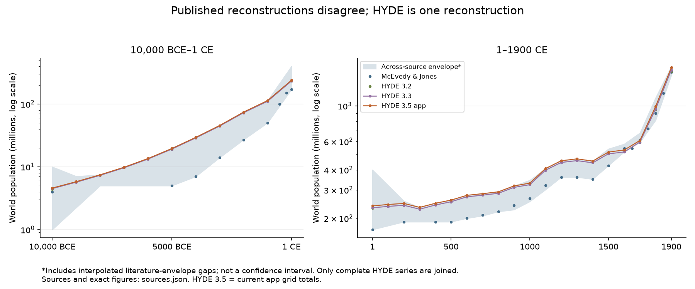

# World population: disagreement across estimates

## Question

How much do published world-population estimates disagree during the app's HYDE era
(10,000 BCE–1900 CE), and what could the counter communicate without implying
statistical certainty?

## Context

[Direct] The task's premise is substantially correct at commit `ba892f8`.
[`HYDE_TOTALS` and `PEOPLE_TOTALS`](../../../footsteps-web/lib/time.ts:25) give each
HYDE year identical low, central and high values; 1000 BCE is 113.42 million.
[`TimeReadout`](../../../footsteps-web/components/ui/TimeReadout.tsx:40) already adds
“~”, so this is an approximate single number, not an entirely unqualified precise
headcount. Pre-HYDE years have a model range. No comparison dataset existed.
The [vision](../../philosophy/vision.md) asks the map to convey how little we know.
No UI, runtime import, grid, or existing population total changes in this task.

## Scope

Compare historical reconstructions and published bounds. Store a small envelope
for all 30 `TARGET_YEARS`, preserve the source figures, and propose copy for the
parallel counter redesign (Steady `e599bf27`). This is not a new best estimate, an
exhaustive bibliography, or an estimate of local spatial error.

## Findings

### The disagreement is real, but a source spread is not a probability interval

[Direct] The [US Census compilation](https://www.census.gov/data/tables/time-series/demo/international-programs/historical-est-worldpop.html)
reports named authors' estimates and sometimes their lower/upper bounds. It is a
compilation, not a separate independent reconstruction. Its Summary column is
excluded from our calculation to avoid double counting. The source columns are
retained individually, including UN 1973 and 1999 and Haub for context.

[Supported] These estimates are not independent samples. For example, Jones's
[Table 1](https://web.stanford.edu/~chadj/bc400.pdf) explicitly reproduces Kremer's
levels; Kremer substantially reuses McEvedy & Jones. HYDE versions also share a
lineage. Min/max is useful descriptive disagreement, but has no probability
coverage. Do not call it a 90%/95% confidence interval or say the true population
must fall inside it. A narrow spread may reflect shared assumptions or few
available estimates.

### Source register and exact figures

[Direct] [`sources.json`](sources.json) contains 193 anchors across 13 named series.
Each `[year, low, high]` triple inherits its enclosing source's title, URL and
locator: **every figure has a citation**. Values are persons, not millions;
point estimates have equal bounds. Negative years mean BCE. Published 1 CE is
mapped explicitly to app year 0, as Jones also does; this is an indexing seam,
not a historical claim that the calendars have a year zero.

| Series | Retrieval and coverage used | Examples, millions |
| --- | --- | --- |
| McEvedy & Jones (1978) | Census named column; Atlas pp. 342–351; 10,000 BCE–1900 | 4 at 10,000 BCE; 50 at 1000 BCE; 170 at 1 CE |
| Biraben (1980) | Census named column; original table 2; 400 BCE–1900 | 255 at 1 CE; 254 at 1000; 460 at 1500 |
| Durand (1974) | Census lower/upper columns; original table 2; 1 CE–1900 | 270–330 at 1 CE; 275–345 at 1000 |
| Thomlinson (1975) | Census lower/upper columns; original table 1; 10,000 BCE–1900 | 1–10 at 10,000 BCE; 5–20 at 5000 BCE; 200 at 1 CE |
| Haub (1995) | Census column; Population Today p. 5; sparse milestones | 5 at 8000 BCE; 300 at 1 CE |
| UN (1973) | Census lower/upper columns; original p. 10; 6500 BCE–1900 | 200–400 at 1 CE; 813–1125 at 1800 |
| UN (1999) | Census column; The World at Six Billion table 1, p. 5; 1 CE–1900 | 300 at 1 CE; 310 at 1000 |
| Clark (1967) | [Maddison (2001), table B–1, p. 231](https://www.oecd.org/content/dam/oecd/en/publications/reports/2001/06/the-world-economy_g1gh13a3/9789264189980-en.pdf), World row; four benchmarks, 0–1700 | 225.5 at 0; 280.2 at 1000; 427.8 at 1500; 640.8 at 1700 |
| Maddison (2001) | Same book, table B–10 p. 241, World row; eight benchmarks, 0–1913 | 230.820 at 0; 268.273 at 1000; 437.818 at 1500 |
| Kremer (1993) | Jones (2001), Table 1 p. 14; 10,000 BCE–1900 | 4 at 10,000 BCE; 170 at 0; 265 at 1000 |
| HYDE 3.2 | [Klein Goldewijk et al. (2017), §4.1, pp. 934–935](https://doi.org/10.5194/essd-9-927-2017); eight rounded baseline totals | 4.4 at 10,000 BCE; 19 at 5000 BCE; 232 at 1 CE; 1643 at 1900 |
| HYDE 3.3 | [Versioned OWID catalog](https://catalog.ourworldindata.org/garden/hyde/2024-01-02/all_indicators/all_indicators.feather), `World / popc_c`; all 30 app years | 4.501152 at 10,000 BCE; 1670.635648 at 1900 |
| HYDE 3.5 app | [`HYDE_TOTALS` at ba892f8](https://github.com/willhs/footsteps/blob/ba892f8/footsteps-web/lib/time.ts); all 30 app years, derived grid totals | 4.59 at 10,000 BCE; 113.42 at 1000 BCE; 1730.31 at 1900 |

Census values were inspected against its current page and transcribed using an
[HTML mirror](https://pratclif.com/demography/Historical%20Estimates%20of%20World%20Population.htm).
The mirror's UN header says 1993; the original Census says **1973**, which we use.
Blank upper cells mean the lower value is the point estimate, not zero.
Biraben's 254 at 1000 is the Census transcription; other compilations differ by
rounding or edition. We preserve the selected cited values rather than silently
mixing editions. Clark's values here are specifically Maddison's reproduction;
we did not inspect Clark's book or infer his missing dates.

[Direct] HYDE 3.3's [catalog metadata](https://catalog.ourworldindata.org/garden/hyde/2024-01-02/all_indicators/all_indicators.meta.json)
identifies v3.3 and includes the publisher's global totals. We selected `World`,
not sums of present-day countries, and rounded floating-point totals to whole
persons. The full Feather file's SHA-256 is retained in `sources.json`. Do not
substitute OWID's [combined population indicator](https://ourworldindata.org/grapher/population):
its documentation says it switches to Gapminder in 1800, so its 1800/1900 figures
cannot be labelled HYDE 3.3.

[Supported] The version comparison is deliberately asymmetric: HYDE 3.2 is the
paper's rounded baseline, 3.3 is a publisher world-total table mirrored by OWID,
and 3.5 is this app's rounded grid-derived total. Differences can reflect
aggregation/processing as well as version revisions. They are not a controlled
version-to-version experiment or three independent opinions.

### Chart



[Direct] The shaded envelope comes from the committed JSON. Selected series are
shown as points; only the two complete HYDE series are joined. All named series
contribute to the shaded envelope at their available dates. The horizontal scale
is linear within each panel; population is logarithmic. The panels have different
time spans and vertical limits. This is a comparison chart, not the app slider.

### Data contract and derivation

[Direct] [`population_estimates.json`](../../../footsteps-web/lib/population_estimates.json)
is approximately 17 KB and contains `schemaVersion`, `units`, `kind`, `method`,
`sourcesPath`, and `years`. Each year has:

- `year`, `low`, `high`: an inclusive, positive envelope in persons, rounded outward.
- `lowFrom`, `highFrom`: source IDs and anchor years producing each bound.
- `literatureAnchorYears`: one year for a direct comparison, two for an interpolated gap.
- `directSources`: all source series with an actual figure at that app year.

The core model is a source registry, cited anchors, and a derived envelope. The
invariants are unique ascending years, finite positive low ≤ high, full
`TARGET_YEARS` coverage, and traceability of each bound. No runtime API or new
central estimate is introduced.

1. At every available comparison date, take the minimum lower and maximum upper
   across the historical literature plus HYDE 3.2's published paper anchors.
2. Where that comparison has no figure, interpolate the **envelope** geometrically
   between adjacent comparison dates: `a * (b/a)^f`. Do not extrapolate, carry
   values forward, or interpolate each author's sparse sequence across millennia.
3. Include HYDE 3.3 and the app's 3.5 totals at every app year. This ensures the
   displayed map total remains inside the comparison envelope without allowing
   two similar HYDE versions to masquerade as a well-constrained literature range
   at dates missing from the comparison tables.
4. Store the outer bounds, their source/year references, and whether the literature
   bracket is interpolated. No assumption that population grew monotonically.

[Inferred] This is a reproducible descriptive policy, not an uncertainty model.
The comparison's composition changes with available sources. At 1600, for example,
Clark has no anchor in our selected table; the range must not be read as a full
survey of his or anyone else's work. Bounds at 9000, 7000 and 6000 BCE and 100 and
300 CE include interpolated literature gaps, not newly discovered estimates.
Long per-source interpolation was rejected: interpolating UN 1973 between 6500
BCE and 1 CE would invent an upper bound near 227 million at 1000 BCE, despite no
UN observation there. Interpolating the adjacent-date envelope avoids that claim,
but cannot reconstruct unobserved demographic shocks either.

| App year | App HYDE total, M | Envelope, M (display-rounded) | Interpretation |
| --- | ---: | ---: | --- |
| 10,000 BCE | 4.59 | 1–10 | Thomlinson's published bounds set both ends |
| 9000 BCE | 5.80 | 2.2–7.1 | Literature envelope interpolated between 10,000 and 8000 BCE |
| 1000 BCE | 113.42 | 50–113 | McEvedy/Kremer low; app HYDE high |
| 1 CE (app 0) | 238.73 | 170–400 | McEvedy/Kremer low; UN 1973 upper |
| 1000 CE | 330.53 | 254–345 | Biraben low; Durand upper |
| 1900 CE | 1730.31 | 1550–1762 | UN 1973 published bounds |

Display rounding above is illustrative. The hypothetical “50–150 M” in the task
is not supported by this particular source set at 1000 BCE.

### HYDE's own scenarios are a separate question

[Direct] HYDE 3.2's paper reports baseline and uncertainty scenarios separately:
232 M at 1 CE, with its own 58–406 M bounds (§4.1), wider than its cited literature
range of 170–330 M. The abstract even gives a lower scenario below 0.01 M at
10,000 BCE. These are expert-judgment scenarios, not additional independent
reconstructions. The [3.3 README](../readme_HYDE_3.3.txt) likewise lists baseline,
lower and upper releases. We include HYDE **baseline** totals only; blending
scenario bounds into the across-author envelope would change its meaning.

## Conclusions

[Supported] Showing one HYDE number hides meaningful disagreement. A quiet,
explicitly labelled comparison range can improve the counter, provided it does
not promise probability coverage or falsely imply many independent estimates at
every year. The existing map can keep its HYDE total and distribution; a world
range says nothing about the reliability of individual cells.

## What We Don't Know

- Publisher-hosted HYDE downloads were not accessible: the Utrecht vault returned
  an Anubis access-denied page and the portal timed out/refused connection. The
  versioned OWID mirror supplied 3.3's table instead. Searches included HYDE 3.3/3.5
  global totals and download text files. No raw grids are in this checkout.
- We did not re-sum HYDE 3.5 or independently verify its publisher world totals.
  The app totals are explicitly identified as project-derived evidence. The
  3.2–3.5 comparison does not isolate revisions from processing effects.
- Several original historical books were not directly inspected. Census supplies
  attribution and table/page locators; Clark and Kremer are explicitly reproduced
  through Maddison and Jones. Later editions may disagree with these selections.
- The envelope is sensitive to which works and dates are available. It is not
  exhaustive, not a defensible statistical uncertainty band, and not proof that
  all plausible estimates fit inside it. Local spatial uncertainty remains unknown.

## Recommendations

[Inferred] For `e599bf27`, keep the HYDE number large because it matches the map,
and add quiet secondary copy. For example at 1000 BCE:

> ~110 million people<br>
> Estimates span roughly 50–110 million

A source/detail affordance should say: “Across selected historical estimates,
including HYDE. This is not a confidence interval.” At interpolated literature
dates (and between slider anchors), use “Indicative range” and explain that the
range is interpolated. Keep the pre-HYDE model's uncertainty label distinct from
this comparison. Do not imply the map is measured with census precision merely
because the code calls this era `measured`.

| Option | Benefit | Cost / judgment |
| --- | --- | --- |
| HYDE total large, range underneath | Keeps total aligned with the rendered population; explains disagreement | Recommended; needs one short label and source disclosure |
| Range alone | Makes uncertainty prominent | Loses the single total matching the map; conflates this source spread with prehistory model uncertainty |
| HYDE total alone with “~” | Minimal space | Current behavior; insufficient to show disagreement of this magnitude |

Use roughly two significant figures for display and one shared unit. Preserve
full stored values for reproducibility; their precision is computational, not
historical. Do not compute a consensus mean from these dependent series. The UI
redesign can import this JSON later; this task intentionally leaves it unused.

## Reproduction and verification

From the repository root:

```sh
python docs/research/0005-world-population-estimates/build.py --chart
python docs/research/0005-world-population-estimates/build.py --check --chart
```

The first command regenerates the JSON and PNG from the reviewed anchors; the
second checks both byte-for-byte and validates anchor ordering, units, coverage,
source metadata, and regression bounds. Chart rendering needs matplotlib (used
with 3.11.1); JSON-only generation/checking uses the standard library. Source
fetching is deliberately separate: downloaded source files must not silently
change the reviewed inputs. The chart was visually inspected for clipping,
legibility, units and source labels. No application behavior changes, so browser,
static-export and deployment checks are outside this task's verification scope.
