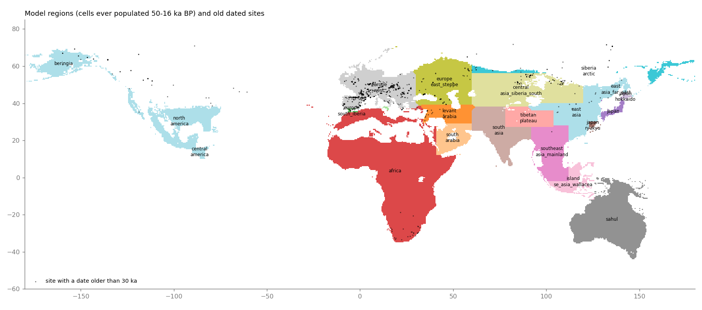
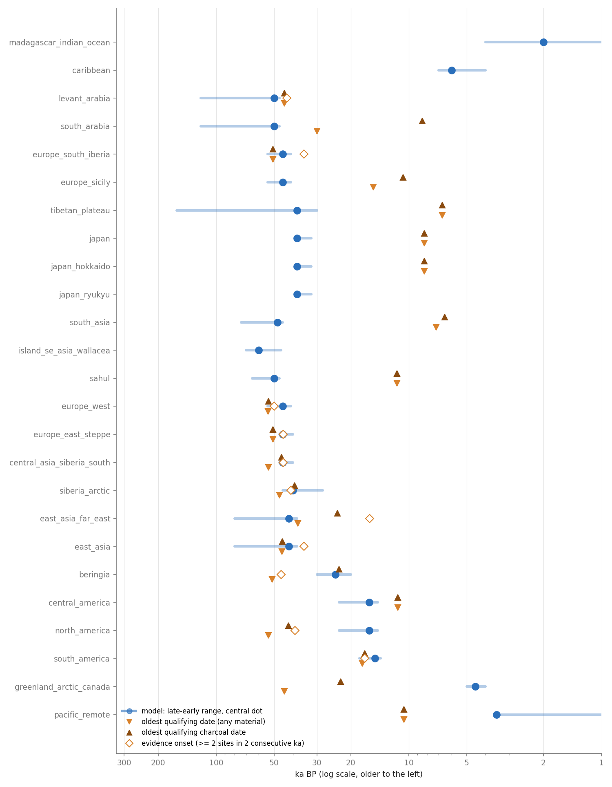
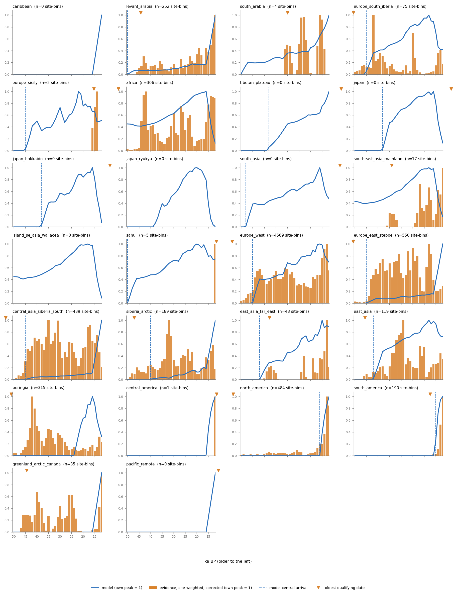
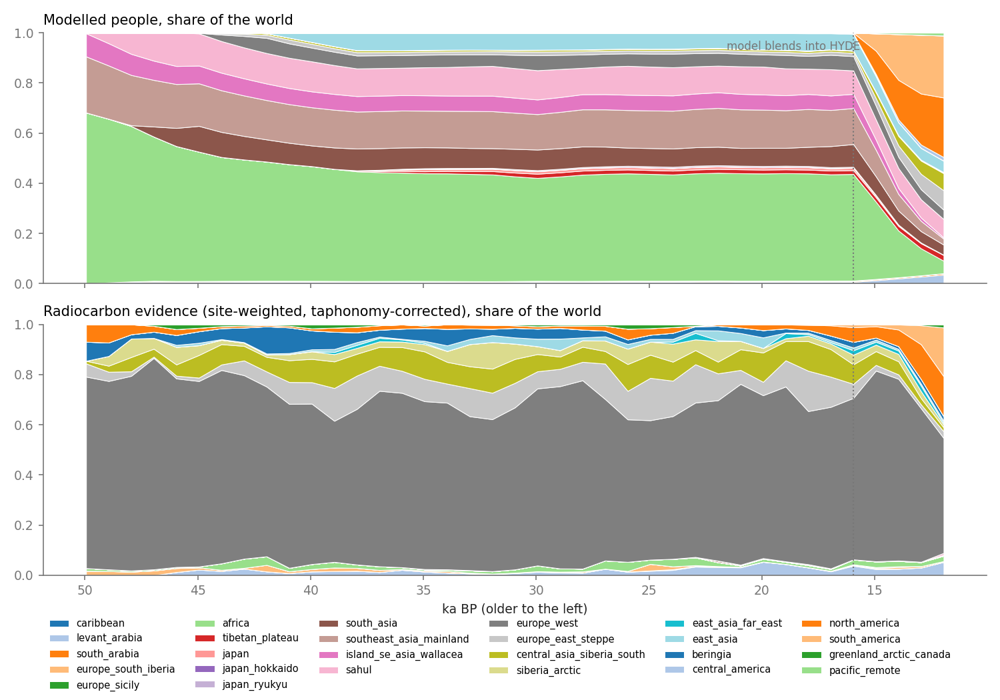
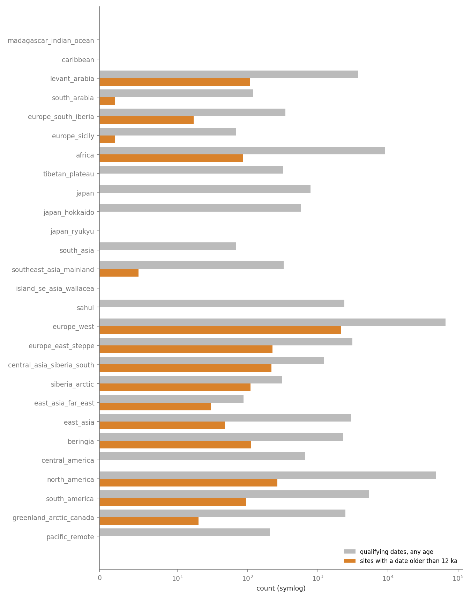

# The modelled population against radiocarbon evidence, region by region

**Update, 2026-11-14:** the original analysis and tables below record the pre-fix baseline.
P1, P2 and P4 have now been applied, together with P9's post-blur arrival mask (not its HYDE-blend
change). The **After the region corrections** section reports the regenerated state; `results.json`
and all five charts now use that state. The original findings remain here as the before comparison.

## Question

[Research 0002](../0002-pre-hyde-population-model/research.md) built the pre-HYDE people (`prehistory_population.py`, arrival table `prehistory/arrivals.yaml`): productivity × dispersal, scaled to a published world curve. [Research 0003](../0003-p3k14c-earliest-dates-by-region/research.md) ingested p3k14c and listed the earliest dates. For each of the 20 arrival-table regions, from about 50 ka BP to the hand-over to HYDE: does the modelled population have the same **timing** and **relative shape** as the dated sites, and where does it not? This note proposes model changes; **it changes nothing in the model.**

## Verdict

1. **The biggest disagreement is geometry, not archaeology.** The model gives each cell to the *first* box in `arrivals.yaml` that holds it. Because `africa` ([-20,-35,52,37]) is listed before `levant_arabia`, the Levant, Arabia west of 52°E and Iran west of 52°E are "Africa, present since 300 ka" (people at Jerusalem and Hatay in the 100 ka image). `tibetan_plateau` owns **zero** cells. Southern China is "mainland Southeast Asia, 70 ka". Luzon and a strip of Honduras are the "remote Pacific, 3.5 ka" catch-all. Section 1.
2. **No region is flatly contradicted by credible evidence.** Where evidence exists before the model's arrival it is either Neanderthal-era (Europe, Altai), or fauna and wood (Beringia, North America, northern Canada), which p3k14c cannot tell from people. Section 3.
3. **One timing disagreement looks real: Siberia.** Evidence has people there from about 41 ka (Ust'-Ishim ~44 ka is in the box); the model starts at 32 ka. Section 2.
4. **One shape disagreement is robust: west Europe at the last glacial maximum.** The model rises 50% from 36-30 ka to 26-20 ka; the evidence is flat or down (ratio 0.79-1.01 raw, 0.51-0.64 taphonomy-corrected, under all three filters), and west Europe has 10× the data of any other region. Central Asia and the steppe lean the same way but flip under tighter filters; East Asia and Africa agree with the model or are too noisy to say. Section 4.
5. **41% of the modelled people at 20 ka sit in regions the evidence cannot see** (southern and island Southeast Asia, South Asia, Sahul): zero or near-zero dated sites older than 12 ka in p3k14c. Their weights are unconstrained by this evidence, which is a coverage result, not support. Section 5.

Evidence cannot give absolute population. Everything below uses it for **relative shape and timing only**; no number here is a head count.

## Method

### Model side

The 91 shipped images (`data/tiles/prehistory/humans_{year}.webp`, 49.95 to 12.95 ka BP at 1 ka steps, plus HYDE's 10,000 BCE image at 11.95 ka) are decoded with `grid_image.decode` and summed per arrival-table region with the model's own rule (first box holding the cell centre, else the nearest box; checked cell-for-cell against `prehistory_population.assign_regions` in `test_model_vs_evidence.py`). The images match `totals.json` (1,666,458 people at 40 ka BP in the image, 1,666,493 in the totals). **From 15.95 ka BP the images are blended into HYDE** (weight 0 → 1 by 11.95 ka), so the model curves below 16 ka partly show HYDE. Shape statistics use 50-16 ka only; 16-12 ka is drawn but not scored.

### Evidence side

- **Dates:** the 168,393 calibrated p3k14c dates of research 0003, filtered the same way: terrestrial carbon, on the curve, 1-sigma error ≤ 1,500 years, placed at least to province level (`LocAccuracy` ≥ 1). 151,732 remain. The date's region is assigned by the same box rule as the model, so model and evidence are compared region by region on identical geography.
- **Per-date probability** is the date's 95.4% HPD intervals with the mass spread evenly across them (an approximation of the full calibrated density), per 1 ka bin centred on each model image age.
- **Three evidence curves per region and bin:** `sites` = expected number of sites with a date in the bin (noisy-or over each site's dates, so a site with 200 dates counts once); `spd` = summed probability, one per date; `spd_site` = the same with every site weighing 1 in total. The charts use `spd_site`; the onset tables use `sites`.
- **Taphonomic correction:** each bin is multiplied by `f(12.95 ka) / f(t)` with `f(t) = 5.726442×10⁶ (t + 2176.4)^−1.3925309` (Surovell et al. 2009, *J Archaeol Sci* 36:1715, the form and constants of R `rcarbon::transformSPD`; the constants were confirmed against that package's documentation in this pass). It lifts a 50 ka bin by 5.6× and a 30 ka bin by 2.9×, so it also amplifies noise at the old end: a bin with one site becomes about five. Surovell fitted it to a global sample of volcanic deposits; local erosion and burial differ, and it does not model the radiocarbon method's own loss (small samples, contamination, the 50 ka limit). **Treat the corrected curve as the upper bound on how much older periods were under-recorded, and the raw curve as the lower bound.** Where the answer depends on the choice, the note says so.
- **Sensitivity runs** repeat the comparison with error ≤ 500 years and with charcoal only (charcoal, charred and burnt material, much less likely than bone or wood to be a mastodon or driftwood). The conclusions below hold in all three unless stated.

### Bias caveats (stated once, apply throughout)

1. **Effort, not people.** 66,567 qualifying dates in west Europe, 144 in South Asia, 0 in Island Southeast Asia (chart 4). A region's curve is scaled to its own peak so effort drops out of shape comparisons, but **shares between regions (chart 1) are dominated by who dated what**; 65% of the world's corrected evidence at 20 ka is west European.
2. **No hominin field.** p3k14c records no species. Before ~41 ka, Europe's and the Altai's dates are largely Neanderthal and Denisovan; p3k14c also holds mammoth dung, horse bone and wood (research 0003).
3. **Coverage gaps.** Sahul's records stop at ~10 ka, Japan's start at 8.3 ka, Island Southeast Asia has none (research 0003). "No evidence" there is "not in this database".
4. **Province-level locations.** 53% of dates are province centroids and almost every Pleistocene date is one. Fine for regions, wrong for sites; it also lets a date near a box edge fall in the neighbour.
5. **Calibration plateaus and the 50 ka limit.** Bins older than ~45 ka are at the edge of the method; `evidence_first` is therefore bounded below by ~50 ka.
6. **Rank correlation on two trending series** (used in section 4) is inflated; it is reported but is not the test.

## Findings

### 1. Region geometry: the box rule does not do what the table says



Chart 5 colours every cell the model ever populates (50-16 ka) by its region; black dots are sites with a date older than 30 ka. `results.json` → `checkpoints` runs 25 named places through the rule:

| Place | Gets region | Its central arrival (ka BP) | Intended |
|---|---|---|---|
| Jerusalem, Hatay (Ücağızlı), Riyadh, Tehran | `africa` | 300 | `levant_arabia`, 50 |
| Gibraltar | `africa` | 300 | `europe_west`, 45 |
| Lhasa | `south_asia` | 48 | `tibetan_plateau`, 38 |
| Xiahe, Qinghai Lake | `east_asia` | 42 | `tibetan_plateau`, 38 |
| Kunming, Guilin, Yuchanyan (Hunan) | `southeast_asia_mainland` | 70 | arguably `east_asia`, 42 |
| Beijing | `central_asia_siberia_south` | 45 | `east_asia`, 42 |
| Fukuoka (Kyushu), Vladivostok | `east_asia` | 42 | Kyushu: `japan`, 38 |
| Manila (Luzon), Tegucigalpa (Honduras) | `pacific_remote` | 3.5 | Luzon: island SE Asia, 60; Honduras: Americas, 15 |

The busiest cell in the 3×3 around Jerusalem and Hatay holds 13 and 33 people in the 100 ka image and 60 and 155 at 50 ka: the Levant is populated under the "Africa" row for the whole window, while the `levant_arabia` row (central 50 ka, "early exits not lasting") governs only what is left: east of 52°E and a 1° strip north of 37°N (788 cells ever populated). `tibetan_plateau` owns 0 cells; its 8 ka ramp and 38 ka date do nothing. (The Americas boxes behave as intended: `south_america` and `north_america` hold nobody before their arrival dates, apart from the edge leakage below.)

**Leakage into regions that should be empty.** A few hundred to ~1,000 modelled people sit in regions before their arrival: Madagascar 1,047 and `pacific_remote` 900 at 50 ka (4,300 at 20 ka). The likely cause for Madagascar is the 1.5-cell blur of the occupancy mask across the `africa` box edge at 43°E; neither source was traced cell by cell. From 16 ka the HYDE blend adds more (`pacific_remote` 57,796, Caribbean 1,380 and Greenland 520 at 14 ka BP). These are under 1% of the world but make a region's "first people" date meaningless below a few thousand people; the tables use "first bin at 2% of the region's own peak" for that reason.

**What the evidence says about the Levant box** (Levant 32-42.5°E, 29-38°N, all owners): dates begin at 44.2 ka (Ücgiz Cave and Udoli Samoty, both listed under Turkey, and Ucagizli Magara, 43.1 ka; charcoal), ~3 sites per ka from 40 ka, rising to 12 at 15 ka. The model has 3,846 people there at 50 ka rising to 14,340 at 17 ka. Shapes agree; the *timing* is set by the box-order accident, not by the table.

### 2. Arrival timing

Chart 3 (below) and the table compare the table's central date (bar = late-early range) with what the evidence shows. **Evidence onset** = the oldest bin from which at least 2 occupied sites per ka hold for 2 consecutive bins. **Model first** = first bin at ≥ 2% of the region's own 50-12 ka peak (a value of 49.95 means present from the start of the window; for `madagascar`, `caribbean`, `greenland`, `pacific_remote` it is edge leakage, not arrival).



| Region | Table central (early-late) | Ramp ka | Model first | Evidence onset | Oldest qualifying date (any material) | Oldest charcoal | Dated sites >12 ka | Reading |
|---|---|---|---|---|---|---|---|---|
| africa | 300 (315-200) | 0 | 49.95 | 46.95 | 53.9 Spitzkloof A | 51.8 | 207 | Consistent; evidence is at the 50 ka limit |
| levant_arabia (as the model assigns it: east of 52°E) | 50 (120-47) | 3 | 49.95 | 14.95 | 15.2 Belt (Iran) | 15.2 | 8 | Meaningless: the real Levant is under `africa` (section 1); the Levant box has onset 44.2 ka |
| south_asia | 48 (74-45) | 3 | 46.95 | none | 7.2 Mahadaha | 6.5 | 0 | **Untestable** (144 dates, all Holocene) |
| southeast_asia_mainland | 70 (86-46) | 5 | 49.95 | none | 34.0 Longtanshan (S China) | 34.0 | 5 | **Untestable** for 70 ka; 5 sites >12 ka, all southern China |
| island_se_asia_wallacea | 60 (70-46) | 3 | 49.95 | none | none | none | 0 | **No data** |
| sahul | 50 (65-47) | 4 | 48.95 | none | 11.5 Wombeyan Caves | 11.5 | 0 | **Untestable** (database stops ~10 ka) |
| europe_west | 45 (54-41) | 3 | 43.95 | 49.95 | 53.8 Esquilleu (Spain, province level) | 53.6 | 2,158 | Evidence older than the table, but pre-41 ka is Neanderthal-era; **cannot test sapiens arrival** |
| europe_east_steppe | 45 (47-40) | 4 | 43.95 | 44.95 | 50.7 Tischoferhöhle | 50.7 | 226 | Consistent (Kostenki ~45-42 ka) |
| central_asia_siberia_south | 45 (47-40) | 4 | 42.95 | 44.95 | 53.4 Chagyrskaya | 45.8 | 218 | Consistent; Chagyrskaya is a Neanderthal cave |
| siberia_arctic | 32 (45-28) | 4 | 29.95 | 40.95 | 47.0 Bunge-Toll | 39.2 | 113 | **Evidence about 9 ka earlier** (Ust'-Ishim, a sapiens genome at 44 ka, lies in this box) |
| east_asia | 42 (80-38) | 4 | 40.95 | 34.95 | 45.6 Xujiacheng, 45.3 Xiaogushan | 45.3 | 68 | Oldest dates agree with 42 (slightly older); occupation then stays thin (1-2 sites per ka) until ~35 ka |
| japan (box also holds the Russian Far East) | 38 (38-32) | 3 | 37.95 | none | 35.5 Ogonki V (Sakhalin) | 23.4 | 6 | **Untestable** for Japan proper: Japan-country dates (1,364) start at 8.3 ka |
| tibetan_plateau | 38 (160-30) | 8 | none (0 cells) | none | none in the box | - | 0 | Plateau interior (80-100°E, 30-36°N): 93 dates, oldest 6.5 ka |
| beringia | 24 (30-20) | 4 | 22.95 | 45.95 | 51.1 O- (willow wood), 49.2 Sixtymile (horse) | **23.0** | 111 | Older dates are wood and fauna. The oldest charcoal date, 23.0 ka, matches the central date |
| north_america | 16 (23-14.5) | 3 | 14.95 | 38.95 (charcoal only: 19.95) | 53.4 Hillsborough Mastodon (dung), 51.3 Mill Creek (wood) | 42.2 | 265 | Old rows are fauna and wood. A sustained rise starts at ~17 ka (5.8 → 14.7 → 31 → 135 sites per ka at 18.9, 16.9, 14.9, 12.9 ka), consistent with 16 ka ± 2 |
| south_america | 15 (18-14) | 3 | 14.95 | 16.95 | 17.4 Muaco | 16.9 | 95 | Consistent with the 18-14 range |
| greenland_arctic_canada (box also holds Alberta, Yukon east of 140°W) | 4.5 (5-4) | 1 | leakage | none | 44.3 North Head (fauna) | 22.6 | 20 | Older dates are fauna; the box is too large for "Arctic" |
| pacific_remote, madagascar, caribbean | 3.5 / 2 / 6 | 1 | leakage | none | El Gigante 11.4 ka (Honduras) | - | 0 | Honduras is in `pacific_remote` by accident (section 1) |

Reading across: **where evidence exists and can be trusted for people (East Asia, the steppe, central Asia, the Americas, Levant box), the table's central dates sit within ~2 ka of it.** The disagreements are Siberia (model too late by ~8 ka), the ramps (below) and every row where the evidence is silent for coverage reasons.

**Ramps.** In the three Eurasian regions with dense data the evidence fills up faster than the model after onset: the date at which the 3-bin mean reaches half its 30-20 ka level is 45.95, 43.95 and 44.95 ka for west Europe, the steppe and central Asia, against 40.95 ka for the model in all three. West Europe's is contaminated by Neanderthals; the steppe and central Asia are within 1 ka of their onsets, so their 4 ka ramps look about twice too slow. East Asia goes the other way (evidence stays thin to ~35 ka; model reaches 70% of its 30 ka level by 38 ka). These are small-count statistics (a few sites per bin); read them as direction only.

### 3. Model has people and evidence has none, and the reverse

Read strictly ("the evidence is well sampled before the model's arrival date and still shows nothing") this finds **no contradiction**. Every region where the model has people and the evidence is empty fails the sampling test (chart 4), so the empty evidence says "not in the database", not "no people":

| Model has people, evidence none | Model share at 20 ka | Why it is not a contradiction |
|---|---|---|
| southeast_asia_mainland | 15.5% | 5 sites >12 ka, all in southern China; Thailand's oldest date is 9.4 ka (research 0003) |
| sahul | 11.1% | 2,407 dates, none older than 11.5 ka: the database stops at ~10 ka BP |
| south_asia | 8.0% | 144 dates, none older than 7.2 ka |
| island_se_asia_wallacea | 6.0% | 0 dates |
| japan, tibetan_plateau | 0.5%, ~0.1% | Japan's records start at 8.3 ka; the plateau interior's at 6.5 ka |

| Evidence present, model has none | What it is |
|---|---|
| north_america 38.95 → 16 ka; beringia 45.95 → 23 ka; greenland-box 44 ka | Mastodon dung, willow and conifer wood, horse, bear, muskox, caribou bone; no archaeology in the oldest rows (research 0003 found the same) |
| europe_west before 45 ka, europe_east and central_asia before ~42 ka | Neanderthal- and Denisovan-era sites |
| siberia_arctic 41-32 ka | **Possibly real**: Ust'-Ishim (44 ka), Mamontovaya Kur'ya (~40 ka, weakly dated), then Yana at 32 ka. The only credible case |

So the useful question is not "which regions disagree" but "which model features are *unconstrained* by evidence". That is 41% of the 20 ka population.

### 4. Relative shape: the glacial maximum



Chart 2 puts each region's model curve and corrected evidence on its own 0-1 scale. The clearest shape test is the **ratio of the 26-20 ka mean to the 36-30 ka mean** (a drop at the glacial maximum shows as < 1), computed for each region with ≥ 100 site-bins in the window:

| Region | Model | Evidence, raw sites | Evidence, corrected |
|---|---|---|---|
| africa | 1.52 | 1.62 | 1.03 |
| europe_west | 1.50 | 0.87 | 0.55 |
| europe_east_steppe | 1.44 | 1.22 | 0.79 |
| central_asia_siberia_south | 1.57 | 0.81 | 0.52 |
| siberia_arctic | 15.2 | 0.85 | 0.56 |
| east_asia | 1.43 | 1.26 | 0.79 |
| beringia, north_america | not comparable (model has no people before 24 / 16 ka) | | |

The model rises 40-60% through the glacial maximum in every region with data. The evidence agrees only in Africa. How far it disagrees depends on the filter, so the table repeats the ratio under the three runs (default: error ≤ 1,500; tight: error ≤ 500; charcoal only), raw / corrected:

| Region (site-bins, default) | Model | Default | Error ≤ 500 | Charcoal only |
|---|---|---|---|---|
| europe_west (4,304) | 1.50 | 0.87 / 0.55 | 1.01 / 0.64 | 0.79 / 0.51 |
| central_asia_siberia_south (428) | 1.57 | 0.81 / 0.52 | 0.96 / 0.61 | 1.52 / 1.00 |
| europe_east_steppe (535) | 1.44 | 1.22 / 0.79 | 1.40 / 0.91 | 0.31 / 0.20 (110 site-bins) |
| siberia_arctic (183; model starts at 32 ka) | 15.2 | 0.85 / 0.56 | 0.88 / 0.57 | 1.54 / 0.98 (42 site-bins) |
| east_asia (143) | 1.43 | 1.26 / 0.79 | 2.65 / 1.68 | 2.44 / 1.57 |
| africa (544) | 1.52 | 1.62 / 1.03 | 2.30 / 1.47 | 1.35 / 0.85 |

- **West Europe is robust.** Under every filter the evidence is flat to down (0.51-1.01), against the model's 1.50, and it has ten times the data of any other region. Even the uncorrected series does not rise.
- **Central Asia and the steppe lean the same way** under the default and tight filters (0.52-1.40) but flip or collapse under charcoal-only (a sample of 42-166 site-bins).
- **East Asia and Africa agree with the model** once the tighter filters are used (1.4-2.7); the default's East Asia dip (0.79 corrected) does not survive. Not a finding.
- Siberia's model ratio is meaningless (it starts at 32 ka); see section 2.

The cause in the model is structural: regional shares barely move between 36 and 20 ka (Africa 43.1% → 43.4%, mainland Southeast Asia 14.9% → 15.5%, Sahul 10.8% → 11.1%, west Europe 5.0% → 4.9%) while the world total is scaled 2.8 M (30 ka) → 4.0 M (21 ka) by choice (`WORLD_CURVE`), so every region inherits about +43%. The ops doc says the cold rule empties northern Europe at the maximum and leaves the southern refugia; as a region total, west Europe nevertheless grows 1.5× (120k at 32 ka, 200k at 22 ka).

**Rank correlations** (50-16 ka, corrected / raw): west Europe 0.30 / 0.90, east Europe 0.51 / 0.78, central Asia 0.34 / 0.80, east Asia 0.62 / 0.79, Africa 0.32 / 0.73. They are high in the raw series mainly because both series trend upward with time; with the correction applied (which removes the preservation trend from the evidence) they fall to 0.3-0.6. Do not read them as validation.

### 5. Regional weights



Chart 1 compares each region's share of the world, model against evidence. The two are **not comparable in level** (west Europe 4.9% vs 65%) because the evidence is research effort. What they can tell us is where the model's weights are *unconstrained*:

- Constrained by evidence of the right kind: Africa, east Europe/steppe, central Asia, east Asia, the Americas after ~17 ka. The model's relative sizes here are plausible against dated-site shapes except for the LGM (section 4).
- Unconstrained: southern and island Southeast Asia, South Asia, Sahul, Japan, Tibet. Together 41% of the model at 20 ka. These weights come from the productivity fit alone, not from any dated evidence.

## Proposed model changes

These proposals were written against the original baseline. P1, P2 and P4 are now applied; P9's
arrival-mask part is also applied. All other proposals remain unchanged. Each says what to change,
why, the confidence, and what would settle it.

| # | Change | Evidence | Confidence | Effect |
|---|---|---|---|---|
| P1 | **Fix the box order.** Move `levant_arabia` (split as Levant/Mesopotamia/north Arabia, e.g. [34,29,60,38], plus south Arabia [41,12,60,29]) *before* `africa`, or give `africa` a north-east limit; add small override regions for south Iberia/Sicily (europe_west) and Honduras/Nicaragua (south_america or north_america). Decide whether the Levant should hold early-exit pulses as an explicit low-density scenario (`alt`) rather than as a side effect of the box. | Section 1: 25 checkpoint places; 100 ka image has people at Jerusalem and Hatay | **High** (a bug against the table's own intent). The *intended* answer for the 120-50 ka Levant is a judgment call: radiocarbon cannot test it | Removes about 3.8k Levant people at 50 ka (13-33 per busiest cell at 100 ka); Arabia and Iran west of 52°E also lose theirs (not separately measured); the Levant start moves from 100+ ka to 50 ka (or a labelled pulse) |
| P2 | **Make the `tibetan_plateau` row apply**: list it before `south_asia`, `east_asia` and `central_asia_siberia_south` (central 38 ka, ramp 8 as written). Also move `japan` before `east_asia` and shrink it to the islands (Kyushu to Hokkaido plus Ryukyu), not Primorye/Sakhalin. | Section 1: 0 cells; Lhasa and Xiahe fall to other regions; Kyushu is `east_asia` | **High** for the order; **low** for the date (evidence silent: plateau-interior dates start at 6.5 ka, Japan's at 8.3 ka) | Plateau gets its slow ramp (arrival 38 ka instead of 48/42 ka); Primorye leaves the Japan row |
| P3 | **Split southern China from mainland Southeast Asia.** Cap `southeast_asia_mainland` at ~22°N (or add a `south_china` row that takes `east_asia`'s dates: central 42-45 ka, ramp ~8). Keep 70 ka only for the mainland south of it, and flag the date as resting on two bones (it already is). | Kunming, Guilin, Yuchanyan fall in the 70 ka region; the oldest date in the region is 34.0 ka (Longtanshan, Yunnan) and 21.5 ka (Yuchanyan); nothing is old enough to support 70 ka, nor can it refute it | Medium for the split (geography); low for 42 ka (the dated sites say "not before 34 ka" but there are 5 of them) | Southern China gets people from ~45 ka rather than 70 ka; mainland Southeast Asia's early people shrink (not quantified) |
| P4 | **Siberia: move `siberia_arctic` central from 32 to 40 ka, ramp 4 → 8**; keep 45 early and 28 late. | Section 2: Ust'-Ishim (44 ka, a sapiens genome) is in the box; evidence ≥ 2 sites per ka from 41 ka; Yana RHS (31.6 ka) is then the *first dense* occupation, not the first | **Medium**: Ust'-Ishim is one individual and Mamontovaya Kur'ya's ~40 ka is weakly dated; the cold limit already removes people in the cold stretches | Small in people (Siberia holds ~500 at 30 ka), visible on the map (Siberian occupation starts ~8 ka earlier) |
| P5 | **West Europe glacial-maximum weight.** Between 36 and 20 ka scale density in `europe_west` so its 26-20 ka / 36-30 ka ratio is about 0.75 (the middle of the raw and corrected evidence, 0.51-1.01 across filters) instead of 1.5, i.e. a multiplier of about 0.5 at the maximum, rising back to 1 by ~16 ka; let the other regions absorb the difference so the world total (a separate choice) is unchanged. Implement as a per-region multiplier curve in `arrivals.yaml`, not by editing `WORLD_CURVE`. Central Asia and the steppe: a smaller multiplier (about 0.7) is suggested, **low confidence**, revisit with ROAD. Do not change Africa or East Asia. | Section 4: robust under all three filters for west Europe only | **Medium** for west Europe (direction robust, size depends on the correction); **low** for the others | West Europe holds ~100k fewer people at 22 ka (200k → about 100k), the other regions slightly more; the glacial-maximum map would show the contraction the documentation describes but the numbers do not |
| P6 | **Ramps: `europe_east_steppe` 4 → 2 ka, `central_asia_siberia_south` 4 → 2 ka, `east_asia` 4 → 8 ka.** | Section 2: the steppe and central Asia fill within 1 ka of onset; east Asia stays thin to 35 ka | **Low** (a few sites per bin; Neanderthal contamination in the first two) | Steeper start in the steppe and central Asia, slower start in east Asia; changes the shape of the first 4-6 ka only |
| P7 | **Leave these dates alone**: `africa`, `europe_west` 45 (evidence is Neanderthal-era), `europe_east_steppe` 45, `central_asia_siberia_south` 45, `east_asia` 42, `beringia` 24 (oldest charcoal 23.0 ka), `north_america` 16, `south_america` 15. | Section 2: all within about 2 ka of evidence a reader can trust for people | Medium-high | None |
| P8 | **Leave the unconstrained rows (`south_asia`, `sahul`, `island_se_asia_wallacea`, `japan`, plateau) on the literature, but widen their low-high ranges** in `totals.json`/the counter: 41% of the 20 ka population has no evidence behind its *weight*. | Section 5 | High that the weights are untested; the range widening is a presentation choice | Counter range, not map |
| P9 | **Clamp edge leakage and the HYDE blend outside the table's regions**: zero the occupancy mask in a region before its arrival after blurring, and exclude Caribbean, Madagascar, Arctic Canada from the HYDE blend until their arrival dates. | Section 1: Madagascar 1,047 at 50 ka; `pacific_remote` 900 at 50 ka and 57,796 at 14 ka | High | Removes <1% of people and keeps "empty until arrival" empty |
| P10 | **Get evidence that can test the unconstrained rows.** ROAD (CC BY-SA; Africa and Eurasia 3 Ma-20 ka) for south Asia, Levant, Siberia and the Altai; AustArch (Australia, plus Pleistocene sites) or the literature for Sahul; the Niah and Tam Pa Ling papers for Island/mainland Southeast Asia (which also resolves the 70 ka date). Add a hominin attribution column so Neanderthal sites stop counting. | Sections 2, 3 | n/a | Needed before any of P3, P4, or P5's non-European weights can be tightened |

Ordering by value: P1 and P2 are bugs against the table's own text and should go first; P5 changes the story the map tells at the glacial maximum, for west Europe; P3 and P4 are the best-supported date changes; P6, P8 and P9 are tuning.

## After the region corrections (2026-11-14)

Regenerated all **90** modelled images, 100,000–11,000 BCE, with `prehistory_population.py --verify`;
10,000 BCE remains the separate measured HYDE image. Both totals files were rewritten and are
byte-for-byte unchanged: regional placement changes, world curve scaling and low/high ranges do not.
Re-ran `model_vs_evidence.py` with the same 151,732 qualifying dates. All charts and `results.json`
now use 27 ordered region boxes. The tables above remain the original baseline.

| Checkpoint | Before | After | Central arrival ka BP |
|---|---|---|---|
| Jerusalem | `africa` | `levant_arabia` | 50 |
| Riyadh | `africa` | `south_arabia` | 50 |
| Lhasa | `south_asia` | `tibetan_plateau` | 38 |
| Fukuoka, Kyushu | `east_asia` | `japan` | 38 |
| Sapporo | `japan` | `japan_hokkaido` | 38 |
| Vladivostok | `east_asia` | `east_asia_far_east` | 42 |
| Ust'-Ishim | `not previously sampled` | `siberia_arctic` | 40 |
| Gibraltar | `africa` | `europe_south_iberia` | 45 |
| Sicily | `not previously sampled` | `europe_sicily` | 45 |
| Tegucigalpa, Honduras | `pacific_remote` | `central_america` | 16 |
| Managua, Nicaragua | `not previously sampled` | `central_america` | 16 |

Japan uses separate Honshu/Kyushu/Shikoku, Hokkaido and Ryukyu boxes; an explicit continental
Far East box prevents nearest-box assignment of Sakhalin back to Japan. Honduras/Nicaragua use
North America's 16 ka date. Levant early-exit pulses remain the documented, unused alternative;
the central run models continuous occupation from 50 ka BP.

| Region | Central / ramp ka | Model first ≥2% of peak, ka BP | Evidence onset, ka BP | Ever-populated cells before blend |
|---|---|---|---|---|
| `levant_arabia` | 50 / 3 | 48.95 | 42.95 | 885 |
| `south_arabia` | 50 / 3 | 48.95 | none | 869 |
| `tibetan_plateau` | 38 / 8 | 37.95 | none | 1026 |
| `japan` | 38 / 3 | 37.95 | none | 176 |
| `japan_hokkaido` | 38 / 3 | 37.95 | none | 56 |
| `japan_ryukyu` | 38 / 3 | 37.95 | none | 54 |
| `siberia_arctic` | 40 / 8 | 37.95 | 40.95 | 613 |

Tibet now owns populated cells (previously **0**, now **1,026** before the blend). Siberia's
central arrival/ramp is **40 / 8 ka**, with early 45 and late 28 unchanged. Its ≥2%-of-peak onset
is 37.95 ka BP, later than the table's first nonzero ramp stage because habitat and peak size matter.
West Europe's LGM model ratio is still **1.49**, against **0.87 raw / 0.55 corrected** evidence:
P5's shape disagreement remains, and no regional multiplier was added.

The first checkpoint population checks after reordering still found blur leakage at Jerusalem
(1.93 synthetic people at 50,000 BCE). Clamping the blurred mask to cells after their arrival
eliminates that leak in every pure-model image. This applies only P9's arrival-mask part;
late-island leakage from the subsequent HYDE blend remains a separate proposal.
The dependent anthropology atlas's `deep` section was also regenerated so its region indices,
dates and population summaries agree with the images; its other sections are unchanged.

Browser verification covers 100,000, 50,000 and 30,000 BCE, plus 28,000 BCE after Tibet's full
ramp (30,000 BCE = 31.95 ka BP is still in the ramp). The reproducible browser check is
`footsteps-web/scripts/verify-prehistory-arrivals.mjs`: it reads served WebP levels and captures
Jerusalem/Lhasa views, plus Units and Dots. Existing deep-link hydration warnings are retained in
its report; the arrival checks do not change that frontend issue.

## What we don't know

- **Whether the Surovell correction is the right size.** It decides, for each Eurasian region, whether the glacial maximum was a trough (corrected) or a plateau (raw). Both are below the model, so the *direction* is robust and the magnitude is not.
- **How much of each region's sites are human.** No attribution; the oldest rows by region (section 2, research 0003) were checked by material and reference title only, not against the papers.
- **The effect of province-level placement near box edges.** About half of dates sit on province centroids, so dates near an edge may be in the neighbouring region. The region totals are fine; onset dates in small regions (Japan, plateau, Levant) could move by a site or two.
- **Whether the HYDE hand-over hides model disagreement.** 16-12 ka is not scored; the model there is increasingly HYDE.
- **Pre-50 ka.** Radiocarbon cannot see it, so the 120-50 ka Levant pulses, the 70 ka Southeast Asia date and Sahul at 65 ka are untested here.
- **Alternatives** to the noisy-or site occupancy and the HPD-interval approximation of the calibrated density (full-density SPDs, Bayesian KDE, Time-series permutation tests as in `rcarbon`); the conclusions do not look sensitive to them but were not run.

## Reproduce

```bash
python footstep-generator/evidence/p3k14c.py fetch && python footstep-generator/evidence/p3k14c.py build
python footstep-generator/prehistory_population.py --verify     # data/tiles/prehistory (or copy the shipped images)
python footstep-generator/grid_image.py -10000                  # HYDE image used as the 11.95 ka point
python footstep-generator/evidence/model_vs_evidence.py         # charts and results.json, about 1 minute
poetry run pytest footstep-generator/tests/test_model_vs_evidence.py -q
```

Needs numpy, pandas, PyYAML and matplotlib. `results.json` holds every series and table in this note: `model_people` (region × bin), `evidence` (raw and corrected), `earliest`, `compare`, `sensitivity`, `checkpoints`, `boxes`. Charts: `chart-1-world-shares.png` … `chart-5-map.png`. Parameters (filters, correction constants, thresholds) are at the top of `model_vs_evidence.py`.

Data: p3k14c 2022.06 (CC0 1.0; Bird et al. 2022, doi:10.1038/s41597-022-01118-7), IntCal20/SHCal20/Marine20, the modelled images of `prehistory_population.py` (Beyer et al. 2020, Krapp et al. 2021, Tallavaara et al. 2018) and HYDE 3.5. Taphonomic correction: Surovell, Finley, Smith, Brantingham & Kelly 2009, *J Archaeol Sci* 36:1715-1724, constants as in R `rcarbon` `transformSPD`.

## Appendix: charts



Chart 4: qualifying dates (grey) and sites with a date older than 12 ka (orange) per region. Where the orange bar is short or absent, "no evidence" means "not in the database".
